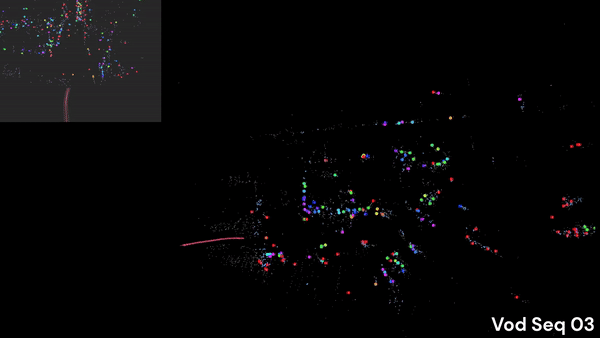
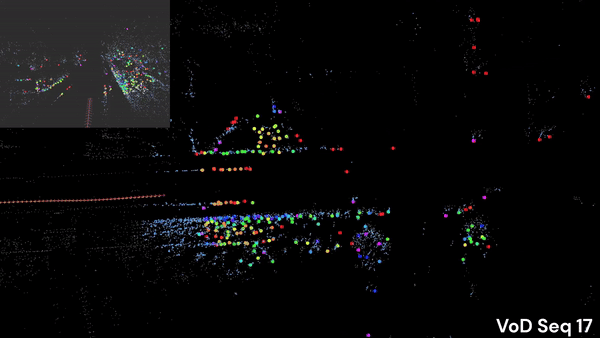

<div align="center">
    <a href="https://ieeexplore.ieee.org/abstract/document/10715681" style="text-decoration:none;">
    </a>
    <a href="https://img.shields.io/badge/ROS-Humble-green" style="text-decoration:none;">
    </a>
</div>

<div align="center">

</div>

# Radar4Motion: IMU-Free 4D Radar Odometry with Robust Dynamic Filtering and RCS-Weighted Matching

Radar4Motion is a robust odometry method that utilizes Doppler and RCS information from the 4D imaging radar's point cloud, even in the presence of noisy and sparse point cloud data.

<div align="center">
<p float="center">

<br />
<b>View-of-Delft Dataset Seq 03</b>
</p>
</div>

<div align="center">
<p float="center">

<br />
<b>View-of-Delft Dataset Seq 17</b>
</p>
</div>

- The above `gif` shows **ONLY** odometry-based mapping results.
    - *NO inertial sensor, NO GNSS sensor, NO loop-closure*
    - **Only Single front-view 4D Imaging Radar!**

## Prerequisites

To run this project, you need:
- **ROS2 Humble** (with development tools)
- Eigen3, for matrix and vector operations
- PCL (Point Cloud Library), for handling radar point cloud data
- nlohmann_json, for JSON parsing
- CMake 3.8 or higher

### System Requirements

- Ubuntu 22.04 LTS (recommended for ROS2 Humble)
- GCC/G++ with C++17 support

## Installation

### 1. Install ROS2 Humble

If you haven't installed ROS2 Humble yet, follow the [official installation guide](https://docs.ros.org/en/humble/Installation.html):

```sh
# Set locale
locale  # check for UTF-8

# Setup Sources
sudo apt update && sudo apt install curl -y
sudo curl -sSL https://raw.githubusercontent.com/ros/ros.key | sudo apt-key add -
sudo apt update
sudo apt install -y software-properties-common
sudo add-apt-repository universe
sudo apt update && sudo apt install -y ros-humble-desktop

# Source setup
source /opt/ros/humble/setup.bash
```

### 2. Install Dependencies

```sh
# Install required packages
sudo apt install -y \
    build-essential \
    cmake \
    git \
    libeigen3-dev \
    libpcl-dev \
    nlohmann-json3-dev \
    ros-humble-pcl-ros \
    ros-humble-sensor-msgs \
    ros-humble-geometry-msgs \
    ros-humble-tf2 \
    ros-humble-tf2-ros \
    ros-humble-tf2-eigen \
    ros-humble-rviz2
```

### 3. Clone and Build the Repository

```sh
# Create/navigate to your ROS2 workspace
mkdir -p ~/ros2_ws/src
cd ~/ros2_ws/src

# Clone the repository
git clone https://github.com/ailab-hanyang/Radar4Motion.git

# Build the project
cd ~/ros2_ws
colcon build --symlink-install

# Source the workspace
source install/setup.bash
```

## Using the [View-of-Delft (VoD) Dataset](https://github.com/tudelft-iv/view-of-delft-dataset)

If you want to evaluate Radar4Motion with the View-of-Delft (VoD) dataset, please do the following:

1. Download or place the VoD dataset in your preferred location.
2. Set VoD dataset path in the launch file parameters or create a symbolic link:
    ```sh
    cd ~/ros2_ws/src/Radar4Motion
    mkdir -p dataset
    ln -s /path/to/view_of_delft_PUBLIC dataset/
    ```

    Folder tree:
    ```sh
    Radar4Motion/
    ├── src/
    │   ├── .cpp files..
    ├── config/
    └── dataset/
        └── clips/
        └── view_of_delft_PUBLIC/  -> symlink to /path/to/view_of_delft_PUBLIC
            ├── radar/
            │   ├── training/
            │   │   ├── velodyne/
            │   │   │   ├── (bin files)
            │   │   ├── pose/
            │   │   │   ├── (label files)
    ```

3. Create a test folder for evaluation (optional)
    ```sh
    cd ~/ros2_ws/src/Radar4Motion
    mkdir -p test
    ```

## Usage

To start the radar odometry processing, launch the provided ROS2 launch files:

### View-of-Delft Dataset (Offline Mode)

```sh
# Source ROS2 workspace
source ~/ros2_ws/install/setup.bash

# Launch offline odometry with VoD dataset
ros2 launch radar4motion radar4motion_offline.launch.py
```

### ROS Topic Mode (Online Mode)

```sh
# Source ROS2 workspace
source ~/ros2_ws/install/setup.bash

# Launch online odometry (subscribes to point cloud topics)
ros2 launch radar4motion radar4motion_online.launch.py
```

#### Example: Bosch premium off-highway radar (MCAP bag)

This radar publishes `sensor_msgs/msg/PointCloud2` on `/off_highway_premium_radar_sample_driver/locations`
and uses the field name `radar_cross_section` for RCS.

```sh
# Launch online odometry with Bosch radar topic + RCS field
ros2 launch radar4motion radar4motion_online.launch.py \
  input_points:=/off_highway_premium_radar_sample_driver/locations \
  rcs_field:=radar_cross_section \
  use_sim_time:=true \
  rviz:=false

# Play bag with simulated time
ros2 bag play /path/to/rosbag --clock
```

To inspect available fields while the bag is playing:

```sh
ros2 topic echo --once /off_highway_premium_radar_sample_driver/locations --field fields
```

### Parameters

The accumulated scans-to-submap matching algorithm requires **precise sensor-vehicle calibration**. You must accurately set the following parameters in the `./config/radar_point_cloud_odometry.ini` file according to your environment:

```ini
m_d_radar_calib_x_m = 3.5
m_d_radar_calib_y_m = 0.0
m_d_radar_calib_z_m = 0.0
m_d_radar_calib_roll_deg = 1.0
m_d_radar_calib_pitch_deg = -0.568
m_d_radar_calib_yaw_deg = 0.43
```

**Note:** For the View-of-Delft (VOD) dataset, exact sensor-vehicle calibration values are not provided by the dataset. We have set approximate values based on the sensor mounting position and vehicle images. These values will be updated through our ongoing *radar4selfcalibration* research.

### Launch File Configuration

You can customize parameters via the launch files or directly through command-line arguments:

```sh
# Example: Override the RViz visualization parameter
ros2 launch radar4motion radar4motion_offline.launch.py rviz:=false
```

## Configurations

Detailed descriptions of parameters can be found in [PARAMETERS](./docs/PARAMETERS.md).

1. **ROS & File path configuration**
    - Files: 
      - [`/launch/radar4motion_offline.launch.py`](./launch/radar4motion_offline.launch.py)
      - [`/launch/radar4motion_online.launch.py`](./launch/radar4motion_online.launch.py)

2. **Radar ego motion estimation** (ref: [REVE](https://github.com/christopherdoer/reve))
    - File: [`/config/radar_ego_motion_estimation.ini`](./config/radar_ego_motion_estimation.ini)

3. **Odometry parameters**
    - File: [`/config/radar_point_cloud_odometry.ini`](./config/radar_point_cloud_odometry.ini)

## Build from Source (Advanced)

If you need to rebuild from scratch:

```sh
cd ~/ros2_ws

# Clean previous build artifacts
rm -rf build/ install/ log/

# Build with verbose output
colcon build --symlink-install --event-handlers console_direct+

# Or build specific package
colcon build --packages-select radar4motion --symlink-install
```

## Troubleshooting

### Build Errors

**Issue:** PCL or Eigen not found
```sh
# Install development headers
sudo apt install -y libeigen3-dev libpcl-dev
```

**Issue:** ROS2 packages not found
```sh
# Ensure you have sourced the ROS2 setup
source /opt/ros/humble/setup.bash

# Update package lists
sudo apt update
```

### Runtime Errors

**Issue:** Point cloud topic not received
```sh
# Check available topics
ros2 topic list

# Monitor point cloud topic
ros2 topic echo /your_point_cloud_topic
```

**Issue:** RViz not launching
```sh
# Ensure rviz2 is installed
sudo apt install -y ros-humble-rviz2

# Launch with explicit rviz:=true parameter
ros2 launch radar4motion radar4motion_online.launch.py rviz:=true
```

## TODO

- [ ] Update voxel struct (frame-scan unit)
- [ ] Update VoD calibration params with Radar4SelfCalibration
- [ ] Add ROS2 service interfaces for parameter updates
- [ ] Implement ROS2 lifecycle nodes for better node management

## Version History

- **v2.0.0** - ROS2 Humble migration
  - Full ROS2 support with modern APIs
  - Updated to ament_cmake build system
  - Python-based launch files
  - Enhanced parameter handling

- **v1.0.0** - Original ROS1 (Noetic) release

## License

This project is licensed under the Apache-2.0 License - see the [LICENSE.md](LICENSE) file for details.

## Authors

- **Soyeong Kim** - soyeongkim@hanyang.ac.kr
- **Jiwon Seok** - jiwonseok@hanyang.ac.kr

## Citation

If you find this work useful, please cite the following paper:

```bibtex
@article{kim2024radar4motion,
title={Radar4Motion: IMU-Free 4D Radar Odometry with Robust Dynamic Filtering and RCS-Weighted Matching},
author={Kim, Soyeong and Seok, Jiwon and Lee, Jaehwan and Jo, Kichun},
journal={IEEE Transactions on Intelligent Vehicles},
year={2024},
publisher={IEEE}
}
```

## Acknowledgement

We would like to express our gratitude to all the contributors and resources that made this research possible.

- **Source Code References:**
  - [KISS-ICP](https://github.com/PRBonn/kiss-icp) - ICP registration algorithm
  - [REVE](https://github.com/christopherdoer/reve) - Radar ego velocity estimation

- **Dataset:**
  - [View-of-Delft (VoD)](https://github.com/tudelft-iv/view-of-delft-dataset) - Benchmark dataset

- **Evaluation Tools:**
  - [evo](https://github.com/MichaelGrupp/evo) - Odometry evaluation package
